# koi-code-aquarium 🐟

A high-resolution, animated koi aquarium for your GitHub profile README.
**Every fish is one programming language from your public repositories.**

<p align="center">
  
</p>

- **One koi per language.** Each fish is drawn by [git-koi](https://github.com/yalongwastaken/git-koi) with only that language's official GitHub colour, so its spots show the language.
- **Grows with your repos.** A koi's length is proportional to how many public repositories use its language, so your top language is the biggest fish and a 1-repo language is a small one. Add a repo in a language, and its koi grows on the next run.
- **High resolution.** Every git-koi pixel becomes a vector square, so the pixel art stays sharp on any screen and at any zoom.
- **Coding theme.** A terminal bar, a dark pond with a grid, faint code written in your languages, glowing circuit traces and rising `{ }` `</>` bubbles, plus a `languages.json` bar under the pond.
- **Custom wallpaper.** Use any image as the pond background.
- **Animated on GitHub.** It uses SVG's built-in animation tags (SMIL), which keep playing when GitHub shows the SVG as an image. The fish swim head-first and their tails wag.
- **Zero npm dependencies.** A single Node.js file.

---

## Use it with GitHub Actions

1. Copy [`examples/workflow.yml`](examples/workflow.yml) into your profile repository as `.github/workflows/koi-aquarium.yml`.
2. Add the aquarium to your profile `README.md`:

   ```html
   
   ```

3. Run the workflow once from the **Actions** tab. After that it runs every night.

### Inputs

| Input | Default | Meaning |
| --- | --- | --- |
| `user` | repository owner | Account to draw |
| `out` | `koi/aquarium.svg` | Output file |
| `max-fish` | `12` | Most languages to show, `1`–`20` |
| `theme` | `code` | `code` adds the grid, code, circuits and bubbles; `plain` leaves just the water |
| `wallpaper` | none | Pond background image in your repository: `.jpg` `.png` `.webp` `.gif` `.svg` |
| `title` | `<user>'s code pond` | Text in the terminal bar |
| `token` | built-in token | Keep the default; only public data is read |

The Action downloads git-koi 1.0.2 from its GitHub release and checks its SHA-256 checksum before using it. It needs a Linux or macOS runner.

---

## Run it on your own computer

You need:
- Node.js 18 or newer
- the [GitHub CLI](https://cli.github.com), signed in with `gh auth login`
- the [git-koi 1.0.2 release](https://github.com/yalongwastaken/git-koi/releases/tag/v1.0.2) for your system

```bash
node koi-aquarium.mjs --user <your-login> --git-koi /path/to/git-koi --out koi/aquarium.svg
```

```text
Options:
  --user <login>        GitHub account to draw (default: $GITHUB_REPOSITORY_OWNER)
  --out <file>          Output SVG (default: koi/aquarium.svg)
  --max-fish <n>        Most languages to show, 1-20 (default: 12)
  --wallpaper <file>    Pond background image (.jpg .png .webp .gif .svg), embedded in the SVG
  --theme <code|plain>  "code" adds the grid, code, circuits and bubbles (default: code)
  --title <text>        Text in the terminal bar (default: "<login>'s code pond")
  --include-forks       Count forked repositories too
  --git-koi <path>      git-koi executable (default: $GIT_KOI, PATH, or ~/profile-tools/koi)
```

Drawing takes about a minute, because git-koi draws each fish separately.

---

## How it works

1. **Count languages.** The GitHub GraphQL API lists your public, non-fork repositories. Each repository counts once, for its primary language. The top `max-fish` languages become fish.
2. **Collect activity.** `git-koi collect` reads your public activity once. That sets the koi's growth and pose.
3. **One koi per language.** For each language, that activity is copied with every repository set to that one language, and `git-koi render` draws a koi spotted only in its colour. Pale colours, such as JavaScript yellow, get git-koi's black koi so the spots stay visible; other colours get the white koi.
4. **Vectorise.** The koi PNG is decoded with Node's built-in zlib. Same-coloured pixels are merged into as few rectangles as possible, and drawn with `shape-rendering="crispEdges"`.
5. **Size.** Each koi's length is `84 + 176 × (its repos ÷ the top language's repos)` SVG units, so the top language is 260 and a language with 1 of 10 repos is about 102.
6. **Swim.** Each fish follows its own smooth loop with `animateMotion` and always faces the way it swims. The back third of its body wags as the tail.

The pond layout comes from a seed made of your login and languages, so the same data always draws the same pond.

## Wallpaper tips

- The image is embedded inside the SVG, because GitHub won't load images linked from an SVG. Keep it under 1 MB.
- About 2000 × 725 pixels matches the pond's shape. Other shapes are cropped to fill it.
- The image is darkened slightly so the fish stand out. Use `theme: plain` to show it without decorations.

## Credits

- Koi art and activity model: [git-koi](https://github.com/yalongwastaken/git-koi) by Anthony Yalong (MIT). This project runs the official git-koi release and doesn't include its code.
- The idea of a multi-fish pond came from [git-koi-aquarium](https://github.com/reginaldalfret/git-koi-aquarium) (MIT).

## License

[MIT](LICENSE) © 2026 Azizul Abedin Azmi
